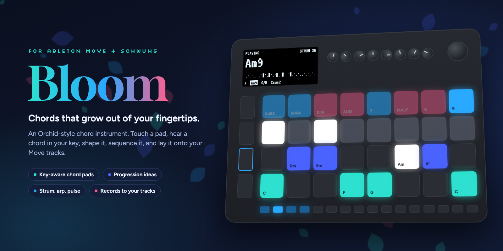
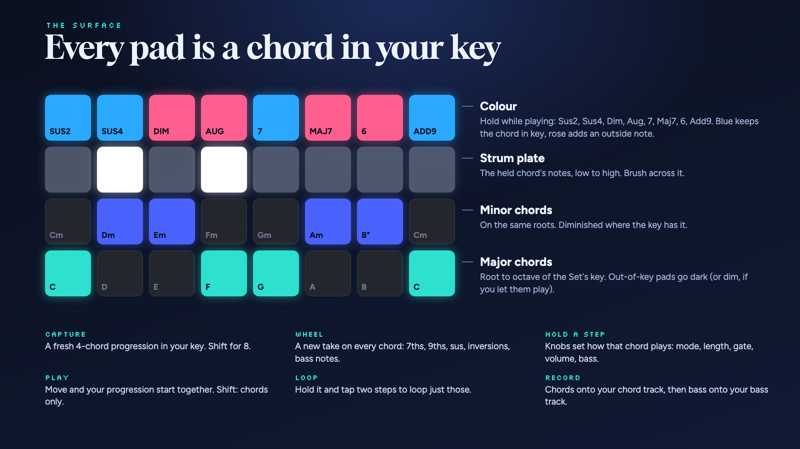

<p align="center"></p>

# Bloom

> **A note on how this is made.** I'm aggressively and unashamedly using AI to build Bloom. I'm also glad to look at anything myself and reply as a human whenever anyone asks. I'm playing with this a lot and trying to make it something that I and others love, so all feedback and pull requests are welcome!

**A chord instrument for Ableton Move, built on [Schwung](https://github.com/charlesvestal/schwung).**

Bloom turns Move's pads into a playable chord surface in the spirit of the Telepathic Instruments Orchid. Every pad is a chord in your Set's key. Hold a pad and you hear a full chord on one of Move's own tracks. Colour it with a 7th or a sus, strum it, arpeggiate it, let Bloom suggest a progression, shape every chord in it, then press Shift + Record and the chords and bass land in clips on your Move tracks, or press Record and play it in yourself.

No laptop, no music theory required, and nothing to route: Bloom plays the instruments already in your Set.

## What you can do with it

- **Jam.** Touch and play. Chords follow the key and scale of your Set, so everything you hit fits. Brush the strum plate, switch to arp or pulse, and ride the wheel through inversions.
- **Find chords for a song.** Out-of-key chords sit one shift away, and the top row shows which colours stay in key (blue) and which add a note from outside (rose).
- **Write a progression for your track.** Press Capture for a fresh 4 or 8 chord idea in your key, built from the progressions songs actually use. Turn the wheel for a new take on every chord until it clicks.
- **Shape every chord.** Hold a step and spin the wheel for a new voicing of just that chord, transpose it, change its octave, and set how long it lasts.
- **Program a performance.** Each step remembers how it plays: chord, strum, two-octave strum, arp, pulse, gate, volume, bass, spread and feel. Your progression becomes a part, not a list of chords.
- **Perform.** Play starts Move and your progression together, locked to Move's clock so they never drift apart. Loop a few steps, jump around with the arrows, and play over the top on the pads.
- **Pick, then strike.** In pick mode, chord pads choose silently and the top row plays the chosen chord in eight voicings, so one hand picks while the other plays.
- **Record it back.** Record takes what you play live (pads, steps, strums) into a clip on your chord track. Shift + Record lays the progression onto your chord track, then the bass onto your bass track. Either way they are normal Move clips you can keep editing.

## The surface

<p align="center"></p>

Rows from the bottom, in C major:

| Row | Pads |
|---|---|
| 1 | Major chords on the key's scale, root to octave: **C** D E **F G** A B **C** |
| 2 | Minor chords on the same roots: Cm **Dm Em** Fm Gm **Am B°** Cm |
| 3 | Strum plate: the held chord's notes, low to high; it stays on the last chord after you let go |
| 4 | Colour: Sus2, Sus4, Dim, Aug, 7, Maj7, 6, Add9 |

Chords in the key are lit; the rest stay dark until you allow them (Shift + wheel click). In other keys the rows start on that key's root, so all the key's chords are always under your fingers.

## Controls

**Playing**

| Control | Does |
|---|---|
| Chord pad | Play the chord. In Hold, tap again to stop it |
| Top row (held) | Colour the chord you play |
| Top row (tapped while holding a chord) | The colour stays on that chord, for strumming; tap again to take it off |
| Colours together | One of each kind combines: a sus, dim or aug, a 7th or 6th, and add9 (so 7 + sus4 is 7sus4, Maj7 + Add9 is maj9). A new one replaces the last of its kind |
| Strum plate | Play the held (or last) chord's notes one by one |
| Wheel | Invert the chord you're holding |
| Wheel click | Smooth voice leading on or off |
| Shift + wheel click | Out-of-key chords playable or hidden |
| - / + | Octave. Shift: move the chord rows a semitone |
| Shift + Loop | Touch and play, or pick then strike |
| Delete + chord pad | Stop a held chord |
| Shift + Delete | All notes off |

**Move's tracks**, with the same gestures as on Move (Bloom presses Move's buttons for you). The chord track's button is lit in the major colour, the bass track's in the minor colour.

| Control | Does |
|---|---|
| Hold a track button + turn Volume | That track's volume |
| Mute + track button | Mute or unmute the track |
| Delete + track button | Delete the track's playing clip |
| Shift + Undo | Move's own Undo (plain Undo is Bloom's, for steps) |

**Progressions** (the 16 step buttons are chord slots, saved per Set)

| Control | Does |
|---|---|
| Capture | New 4-chord progression in your key (Shift: 8) |
| Shift + step | Save the last chord to that step, at the velocity you played it |
| Step | Play it |
| Delete + step | Clear it |
| Undo | Take back the last change |
| Wheel (nothing held) | New take on every chord, left goes back |
| Left / Right | Previous or next chord |
| Play | Start Move and play the progression (the Loop range) locked to Move's clock; again to stop |
| Shift + Play | The same with every step, ignoring the Loop range |
| Hold Loop, tap two steps | Loop just those steps (tap Loop alone for all). While playing, the change lands on the next bar |
| Record | Record a live take onto the chord track: everything you play goes in. Record or Play again to stop |
| Shift + Record | Record the progression: chords to the chord track, then bass to the bass track |

**Hold a step to program it.** The screen shows its eight settings; the ones it sets itself are highlighted.

| While holding a step | Does |
|---|---|
| Knobs 1 to 8 | Play mode, length, speed, gate, volume, bass, spread, feel. Turn to the start for DEFAULT (follow the global knob); gate and volume default to 100%, at the end |
| Wheel | A new take on the chord (left goes back) |
| Wheel click | Back to a plain chord |
| - / + | Transpose a semitone. Long press: an octave |
| Volume knob | Volume |

**Knobs.** Touch a knob to see it. **Hold Menu** to see what all eight do right now (hold Shift too for the Shift layer); the values that differ from the usual are highlighted.

| Knobs | 1 to 8 |
|---|---|
| On their own | Play mode, step length, strum speed or arp rate, sound (on, muted, hold), volume, bass, spread, feel |
| With Shift | Key, scale, (free), (free), chord track, bass track, MIDI out, pad colours (Ocean, Moonlight, Sunset, Classic) |

**Key and scale in Bloom.** Shift + knobs 1 and 2 set a key for Bloom alone, so you can try keys without leaving it; the key shows a `*` while it differs from the Set's. It lasts until the Set's key changes on Move, and Move's own pads and scale stay as they are (Schwung can read Move's key but not set it).

## Install

**From Schwung Manager** (once Bloom is in the catalog): open `http://move.local:7700`, find Bloom, install.

**By hand:** download `bloom-module.tar.gz` from the [latest release](https://github.com/bondobd/schwung-bloom/releases/latest) and unpack it into `/data/UserData/schwung/modules/overtake/` on your Move, or from a clone:

```sh
MOVE_HOST=move.local ./scripts/deploy.sh
```

Then open Bloom from Schwung's overtake menu.

**Requirements:** Ableton Move with Schwung 1.7.3 or newer, and an instrument on the tracks Bloom plays (Track 3 for chords and Track 2 for bass by default, since Track 1 is drums in a new Set).

## Routing, in one paragraph

Since Move 1.5 each track has a MIDI In setting (Shift + track button). Tracks on **Auto** only hear MIDI while selected, so Bloom selects your chord track for you, and hands Move back the track it had when you leave.

The bass (knob 6 on, Shift + knob 6 to choose where) can play on the **chord track** itself or on **a track of its own**. Only one track hears MIDI on Auto, so for live bass on its own track, give that track a MIDI In channel once per Set: leave Bloom, hold Shift, press the bass track's button, set MIDI In to its number. Until then Bloom tells you so and plays the bass on the chord track. Record puts the bass on its own track either way, by recording it in a second pass. In Pulse the bass pulses along with the chords.

## External gear

Shift + knob 7 sets where Bloom's notes go: **Move** (the default), **Move + USB**, or **USB** alone. USB is Move's USB-A port, so plug a class-compliant synth or a USB MIDI interface in there. Chords go out on MIDI channel 1 and bass (when it has a track of its own) on channel 2. Recording still lays clips onto your Move tracks either way.

## Recording tips

- Select empty clip slots on your chord and bass tracks first; Move records into the selected slot.
- Count-in is fine: Bloom waits for it and starts the chords when Move starts recording.
- Shift + Record plays your Loop range, with every step's own settings, so what you hear is what you get.
- For a live take, set your chords up on the steps, press Record, then press the steps (or Left / Right) in time and strum on top. A live take records the chord track only; bass on its own track is heard but not recorded, so set the bass to play on the chord track (Shift + knob 6) to keep it in the take.

## Known issues

- **Stale pad lights after leaving Bloom.** Schwung restores Move's LEDs from a snapshot taken when a tool opens, so lights Move changed underneath can stay lit. Bloom avoids the main cause by handing back the selected track on exit; a fix for the rest has been prepared for Schwung. A restart clears any leftovers.
- Bloom drives Move by pressing its buttons for it (track select, Play, Record). If a future Move update changes those, routing or recording may need an update here.

## Development

```sh
npm test                    # chord theory and UI tests, with Schwung's host stubbed
./scripts/build.sh          # dist/bloom-module.tar.gz
./scripts/deploy.sh         # build and copy to a Move (MOVE_HOST=...)
./scripts/render-art.sh     # re-render the README images (needs Chrome)
```

- `src/ui.js` is the instrument: pads, knobs, the player, recording, LEDs and screen.
- `src/chords.mjs` is the pure chord theory: naming, voicing, scales, progressions and variations.
- `dsp/clock.c` is a tiny native plugin that hands the UI Move's transport position (`get_beat_position`), so playback and recording sit on Move's beat grid. `./scripts/build-dsp.sh` builds it with Docker; the header in `dsp/vendor` is Schwung's (MIT).
- Schwung caches imported modules until Move restarts, so the build gives `chords.mjs` a content-hashed name and updates take effect without a restart.

Releases are cut by tagging `vX.Y.Z` (the version in `package.json`, `src/module.json` and `release.json` must match); GitHub Actions tests, builds and attaches `bloom-module.tar.gz`.

## Credits

Inspired by the [Orchid](https://telepathicinstruments.com) by Telepathic Instruments and by what people love about it and the HiChord. Built on [Schwung](https://github.com/charlesvestal/schwung) by Charles Vestal. Not affiliated with Ableton or Telepathic Instruments.

## License

[MIT](LICENSE)
